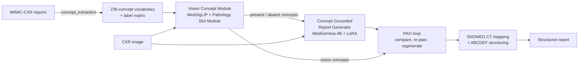

<div align="center">

# MedPAO-VL: Interpretable and Protocol-Compliant Agent for Structured Radiology Report Generation

**Shrish Shrinath Vaidya<sup>1</sup>, Gowthamaan Palani<sup>1</sup>, Minmini Selvam<sup>2</sup>, Gokulraja Srinivasaraja<sup>3</sup>, Ganapathy Krishnamurthi<sup>1</sup>**

<sup>1</sup> Department of Data Science and Artificial Intelligence, Indian Institute of Technology Madras, Chennai, India<br>
<sup>2</sup> TANUH – The AI Centre of Excellence in Healthcare, Indian Institute of Science, Bengaluru, India<br>
<sup>3</sup> Department of Radiology (Division of Interventional Radiology), Ramaiah Medical College and Memorial Hospital, Bengaluru, India

[](#citation)
[](https://openreview.net/forum?id=JxC8OxgmMw)
[](#pretrained-models)
[](#license-and-responsible-use)

Official code for our paper accepted at the **BISCUIT Workshop @ ECCV 2026**.

**📄 Read our paper on arXiv: [here](https://arxiv.org/html/2610.21794v1)**

</div>

---

## Overview

> **Abstract.** Despite the remarkable generalization capabilities of Large Language Models, generating clinically accurate and structured radiology reports from medical images remains a significant challenge. Current end-to-end approaches function as black boxes, prone to factual hallucinations and generating ungrounded findings. This lack of reliability and failure to adhere to domain-specific structuring protocols, fundamentally limits their clinical utility. We present MedPAO-VL, a multimodal agent that shifts the paradigm from monolithic generation to explainable, iterative, protocol-compliant structured report generation. Unlike deterministic models, our plan-act-observe loop functions as a goal-oriented agent: it first perceives the Chest X-Ray through an explainable vision module designed to capture inherent diagnostic uncertainty, then iteratively refines the generated report by observing semantic discrepancies and self-correcting its generation for better alignment with visually detected clinical findings. Evaluation of our framework demonstrates that this agentic reasoning improves clinical correctness and completeness, achieving an expert-rated accuracy score of 3.5/5 and a structural score of 4.3/5. By prioritizing pathology specific explainability and iterative refinement over opaque end-to-end mapping, MedPAO-VL offers a transparent and clinically viable alternative for automated structured radiology report generation.

**Keywords:** Explainability · Structured Report Generation · Multimodal agent · Clinical Protocols · Iterative refinement

MedPAO-VL extends the [MedPAO](https://link.springer.com/chapter/10.1007/978-3-032-06004-4_4) framework with multimodal capabilities. It has three components:

- **Vision Concept Module.** A MedSigLIP-448 backbone with a *Pathology Slot Module*: one attention slot per pathology, a shared classifier that predicts *present / absent / uncertain* for each of 236 concepts, and a per-pathology attention map produced by the forward pass itself. The three-way labels avoid the implicit negative bias of treating unmentioned findings as absent. A similarity loss keeps the attention maps diverse across pathologies.
- **Concept Grounded Report Generator.** MedGemma-4B fine-tuned (QLoRA) to write a report from the image plus the list of present and absent concepts.
- **Agentic Plan-Act-Observe (PAO) loop.** The concepts of the generated report are compared with the vision concepts; discrepancies trigger a re-plan and a regeneration of the missing parts, for up to *N* iterations. The final report is then mapped to SNOMED CT and structured by the ABCDEF protocol (the structured report also has a P entry for the projection/view). A dynamic concept cache lets frequent findings skip ontology mapping and categorization.

## Pipeline



## Repository structure

```
.
├── concept_extraction/     Reports → standardized SNOMED CT concepts → label matrix
├── vision_concept_module/  MedSigLIP + slot-attention concept model (model, dataloader, training)
├── report_generator/       MedGemma-4B zero-shot / LoRA fine-tuning / evaluation (finetune.py)
├── agent/                  Self-correcting report agent and its tools
└── analysis/               Slot and attention-map analysis, t-SNE and similarity plots
```

Each folder has (or links to) its own README with the full options:
[concept_extraction](concept_extraction/README.md) · [agent](agent/README.md) · [analysis](analysis/README.md).

## Hardware and software

> **All models in this work were trained on Intel Gaudi 2 (HPU) accelerators.**

The vision module is built on the Habana PyTorch bridge: `vision_concept_module/model.py` imports `habana_frameworks`, and training uses distributed data parallel over HCCL. The Intel Gaudi software stack therefore has to be installed to train the vision module or to run any script that loads it (including the model-based scripts in `analysis/`). The remaining stages (concept extraction, agent) talk to LLM servers over HTTP and have no hardware requirement of their own.

## Installation

```bash
git clone <this-repository>
cd medpao_vl
python -m venv .venv && source .venv/bin/activate     # Python >= 3.9

pip install torch torchvision transformers peft accelerate datasets trl bitsandbytes evaluate \
            scikit-learn pandas numpy pillow tqdm matplotlib huggingface_hub
```

Further packages are needed only for specific parts: `faiss-cpu`, `llama-cpp-python`, `rapidfuzz` and `psutil` for the agent; `nltk` for concept standardization; `seaborn` and `opencv-python` for the analysis plots; `wandb` for training logs.

MedSigLIP and MedGemma are gated on the Hugging Face Hub. Accept the terms on their model pages and log in before running anything that downloads them:

```bash
hf auth login
```

## Data

We use a subset of [MIMIC-CXR](https://physionet.org/content/mimic-cxr/) (PhysioNet credentialed access): studies whose reports contain HISTORY, FINDINGS and IMPRESSION sections, about 53,000 CXR–report pairs in the training set. The FINDINGS section is the input to the concept extraction pipeline, whose concepts are normalized to SNOMED CT, split into present and absent concepts with DeepSeek-R1-Distill-Llama-70B, and filtered after radiologist validation. The result is a vocabulary of 236 concept groups and about 50,000 (CXR, report, concept) triplets. The MIMIC-CXR test set and the IU X-Ray test set are used for evaluation, with ground-truth concepts obtained by the same pipeline. Data files are not part of this repository; regenerate the concept labels with [`concept_extraction/`](concept_extraction/README.md).

## Usage

### 1. Build the concept vocabulary

```bash
cd concept_extraction

# 1. keep reports with HISTORY + FINDINGS + IMPRESSION
python mimic_simple_filtering.py --root /data/mimic-cxr --output filtered_mimic.csv

# 2. extract concepts with a few-shot LLM served through TGI
python concept_extraction.py --annotation filtered_mimic.csv --base-url http://localhost:8081 \
    --batch-size 4 --limit 4000 --prompt-mode concepts_only --output concepts_df.csv

# 3. standardize to SNOMED CT (SapBERT)
python concept_standardization.py --concepts-csv concepts_df.csv --out-dir standardization_out \
    --desc-file <description snapshot> --rel-file <relationship snapshot> --snomed-index-dir snomed_index

# 4. drop rare concept groups and build the label matrix
python concept_filtering.py --standardization-dir standardization_out --min-freq 100
```

See [concept_extraction/README.md](concept_extraction/README.md) for the arguments of each stage.

### 2. Train the vision concept module

```bash
torchrun --nproc_per_node=2 vision_concept_module/train.py \
    --batch_size 32 --num_epochs 50 --lr 0.000008 --reduced_dim 768 \
    --use_class_weights --early_stopping --save_attention_maps \
    --lambda_attn_loss 0 --lambda_competition 0 --check_freq 10 \
    --exp_name original_slot_attn --checkpoint_dir checkpoints \
    --csv_file <concepts_df.csv> --root_dir <mimic_jpg_dir> \
    --wandb_project cxr_cbm --wandb_run_name original_slot_attn --need_wandb
```

Training was run on Intel Gaudi 2 with DDP over HCCL (`--backend hccl`, `--use_gaudi`, the defaults). The train / validation / test split is stratified on the `clear lungs` concept (`--stratify_column`).

### 3. Train and evaluate the report generator

This can run in parallel with step 2. Split the training set in a stratified way into train / validation / test using `clear lungs` or an equivalent concept, then:

```bash
cd report_generator

# 1) Zero-shot baseline (image only)
python finetune.py --mode zeroshot \
    --test-csv iuxray_test.csv --test-image-dir /data/iu_xray_test

# 1b) Zero-shot with concepts in the prompt
python finetune.py --mode zeroshot --use-concepts \
    --test-csv iuxray_test.csv --test-image-dir /data/iu_xray_test

# 2) QLoRA fine-tuning without concepts, then evaluation
python finetune.py --mode train_eval \
    --train-csv train.csv --val-csv val.csv --train-image-dir /data/mimic_jpg \
    --test-csv iuxray_test.csv --test-image-dir /data/iu_xray_test

# 3) QLoRA fine-tuning with concepts, then evaluation
python finetune.py --mode train_eval --use-concepts \
    --train-csv train.csv --val-csv val.csv --train-image-dir /data/mimic_jpg \
    --test-csv iuxray_test.csv --test-image-dir /data/iu_xray_test

# 4) Evaluate an existing adapter only
python finetune.py --mode eval --use-concepts \
    --adapter-path runs/medgemma_concepts/checkpoint-338 \
    --test-csv iuxray_test.csv --test-image-dir /data/iu_xray_test
```

The same `--use-concepts` switch applies to training, zero-shot and evaluation, so train and test prompts always match. Predictions are saved in the `result/` folder. For clinical metrics such as RadGraph-F1 and CheXbert-F1, use the official repositories of those metrics on the saved predictions.

### 4. Run the agent

```bash
cd agent
python deterministic.py        # deterministic baseline, single pass
python react_cold_cache.py     # PAO loop, no cache lookup ("PAO Full, Cold Cache")
python react_warm_cache.py     # PAO loop + concept cache ("PAO Full, Warm Cache")
```

The agent needs three TGI-compatible servers and the SNOMED index; setup and configuration are in [agent/README.md](agent/README.md).

### 5. Analyse the learned slots

```bash
python analysis/save_slots.py --checkpoint <best_model.pt> --csv_file <concepts_df.csv> --root_dir <mimic_jpg_dir>
python analysis/only_tsne_slots.py --features_dir slot_features --concepts_dict <concepts_dict.json> --output figures/tsne.png
```

See [analysis/README.md](analysis/README.md) for all plots and options.

## Pretrained models

| Model | Description | Hugging Face |
|---|---|---|
| `slot-attn-cxr-medsiglip` | MedSigLIP-448 + slot attention, 236 concepts, loads with `AutoModel` | `shrishSVaidya/slot-attn-cxr-medsiglip` (coming soon) |
| `medgemma-4b-cxr-concepts-lora` | MedGemma-4B LoRA adapter for concept-conditioned findings | `shrishSVaidya/medgemma-4b-cxr-concepts-lora` (coming soon) |

Access to both repositories is **gated**: request access on the model page, accept the Health AI Developer Foundations Terms of Use (research use only), and the request is reviewed manually.

Once released, the vision model loads like any other Hub vision model:

```python
from transformers import AutoModel, AutoImageProcessor

repo = "shrishSVaidya/slot-attn-cxr-medsiglip"
model = AutoModel.from_pretrained(repo, trust_remote_code=True).eval()
processor = AutoImageProcessor.from_pretrained(repo)

out = model(**processor(images=image, return_tensors="pt"))
out.logits       # [1, 236, 3]  class per concept: 0 present, 1 uncertain, 2 absent
out.attentions   # [1, 236, 1024]  attention over the 32 × 32 patch grid
```

## Results

Selected results from the paper (see the paper for the full comparison with prior work and the ablations).

**Concept Grounded Report Generator** (unstructured FINDINGS, without the PAO loop; paper Table 1). "10K" and "50K" are the number of fine-tuning samples:

| Test set | Fine-tuning | BLEU-4 | ROUGE-L | CheXbert-F1 | RadGraph-F1 |
|---|---|---|---|---|---|
| MIMIC-CXR | 10K | 0.102 | 0.298 | 0.563 | 0.376 |
| MIMIC-CXR | 50K | 0.136 | 0.328 | **0.617** | **0.427** |
| IU X-Ray | 10K | 0.083 | 0.327 | 0.203 | 0.342 |
| IU X-Ray | 50K | 0.097 | 0.341 | 0.424 | 0.401 |

**Plan-Act-Observe loop** (MIMIC-CXR test, at most 3 refinement steps; paper Table 6). φ⁺ is the fraction of vision-predicted findings that appear in the final report:

| Configuration | CheXbert-F1 | RadGraph-F1 | GREEN | φ⁺ | Mean iterations | LLM calls | Time (s) |
|---|---|---|---|---|---|---|---|
| Deterministic baseline (`deterministic.py`) | 0.617 | 0.427 | 0.47 ± 0.21 | 0.602 | 1.0 | 6.0 | 218 |
| PAO, cold cache (`react_cold_cache.py`) | 0.634 | 0.448 | 0.61 ± 0.20 | 0.803 | 2.8 | 11.2 | 295 |
| PAO, warm cache (`react_warm_cache.py`) | 0.634 | 0.448 | 0.61 ± 0.20 | 0.803 | 2.8 | 9.8 | 163 |

**Structured reports, radiologist evaluation** (two radiologists, 50 MIMIC-CXR test cases, blinded, scores out of 5, mean ± 95% CI; paper Table 3):

| Method | Accuracy | Structure |
|---|---|---|
| MedGemma 27B | 3.18 ± 0.36 | 3.98 ± 0.24 |
| **MedPAO-VL** | **3.50 ± 0.28** | **4.28 ± 0.20** |

**Limitation.** The diagnostic reach is limited to the vocabulary of 236 concept groups, which restricts the documentation of ultra-rare findings.

## Citation

The paper is yet to be published. The citation will be added here once it is published. In the meantime, the paper is available on [OpenReview](https://openreview.net/forum?id=JxC8OxgmMw).


## License and responsible use

- **Code:** [Apache License 2.0](LICENSE).
- **Model weights:** MedSigLIP and MedGemma are provided under the [Health AI Developer Foundations Terms of Use](https://developers.google.com/health-ai-developer-foundations/terms). Models derived from them are Model Derivatives and are distributed under the same terms, including the Prohibited Use Policy.
- **Data:** MIMIC-CXR is distributed under the PhysioNet Credentialed Health Data License. You must obtain access yourself.
- **Intended use:** research only. These models are not medical devices, have not been validated for clinical use, and must not be used for diagnosis or patient management.
